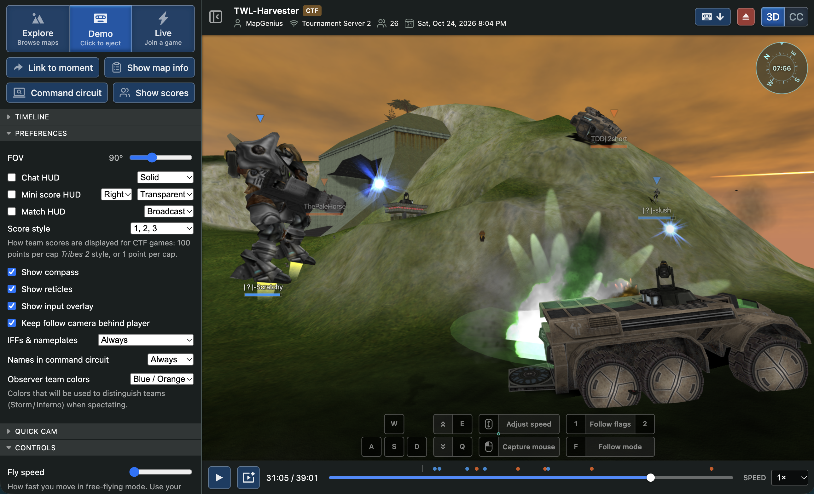

#  MapGenius&trade;

## Tribes 2 in your web browser.



👉 **[Open the app!](https://play.tribes2.online/)**

MapGenius renders Tribes 2 the way the game does, straight from the original game files. Built with Three.js and React.

## Features

- **Maps** – Fly around every stock and community mission, use its observer
  cameras, take camera tours of its flags, stations, generators and turrets,
  or open the command circuit map.
- **Demos** – Play `.rec` recordings: drop in a file, pick a published demo,
  or open one from TribesForever. Seek, change speed, and jump to match events
  on the timeline.
- **Live games** – Browse servers and spectate (or join) live matches from the
  browser, with chat.
- **Follow the action** – Follow any player or flag in third or first person,
  save quick cams, check the score screen, or let the auto-director pick the
  shots. Some demos come with commentary.
- **Shareable links** – Links carry the demo, the time and the camera:
  `?demo=<filename>&t=60`, or `?demo=tribesforever:22945` for a TribesForever
  demo.
- **Recording** – Watched servers are recorded and published as demos.
- **Discord login** – Sign in with your Discord account.
- **Heatmaps** (experimental) – Add `?features=stats`, load a demo, and pick a
  player in the **Stats** panel.

## Controls

Click the view to capture the mouse; <kbd>Esc</kbd> releases it.

### Camera

| Key                                                 | Action                            |
| --------------------------------------------------- | --------------------------------- |
| <kbd>W</kbd> <kbd>A</kbd> <kbd>S</kbd> <kbd>D</kbd> | Fly forward / left / back / right |
| <kbd>E</kbd> / <kbd>Q</kbd>                         | Up / down                         |
| Mouse, drag, or arrow keys                          | Look around                       |
| Scroll wheel                                        | Adjust speed                      |
| <kbd>1</kbd>–<kbd>9</kbd>                           | Observer cameras (maps)           |

### Demo playback

| Key                         | Action                                    |
| --------------------------- | ----------------------------------------- |
| <kbd>Space</kbd>            | Play / pause                              |
| <kbd>[</kbd> / <kbd>]</kbd> | Seek back / forward (hold Shift for more) |
| <kbd>,</kbd> / <kbd>.</kbd> | Slower / faster                           |

### Demos and live games

| Key                                          | Action                                                                  |
| -------------------------------------------- | ----------------------------------------------------------------------- |
| <kbd>F</kbd>                                 | Switch between free-fly and follow                                      |
| <kbd>N</kbd> / <kbd>Shift</kbd>+<kbd>N</kbd> | Next / previous player                                                  |
| Left / right click                           | Next / previous player (mouse captured, with **Enable click to cycle**) |
| <kbd>Tab</kbd>                               | Third / first person                                                    |
| <kbd>Shift</kbd>+<kbd>↑</kbd>                | Keep the camera behind the player                                       |
| <kbd>T</kbd>                                 | Find a player or flag to follow                                         |
| <kbd>0</kbd>–<kbd>9</kbd>                    | Quick cams (<kbd>1</kbd>/<kbd>2</kbd> follow the flags)                 |
| <kbd>Shift</kbd>+<kbd>0</kbd>–<kbd>9</kbd>   | Save a quick cam                                                        |
| <kbd>F2</kbd>                                | Score screen                                                            |
| <kbd>F</kbd> or <kbd>Esc</kbd>               | Take control back from the auto-director                                |

### Command circuit

| Key                                                         | Action                        |
| ----------------------------------------------------------- | ----------------------------- |
| <kbd>C</kbd>                                                | Open / close                  |
| <kbd>W</kbd> <kbd>A</kbd> <kbd>S</kbd> <kbd>D</kbd> or drag | Pan                           |
| Scroll wheel or pinch                                       | Zoom                          |
| <kbd>F</kbd>                                                | Follow / pan (demos and live) |
| <kbd>Esc</kbd>                                              | Close                         |

### Server admin chat commands

Admins on a server MapGenius is watching can control it from global chat,
for example `@MapGenius: -rec +watch`:

| Command             | Action                                      |
| ------------------- | ------------------------------------------- |
| `+rec` / `-rec`     | Keep / discard the demo when the match ends |
| `+watch` / `-watch` | Allow / disallow live watchers              |
| `status`            | Report both settings and pending votes      |

Settings reset when the map changes.

## How it works

The app loads the real Tribes 2 assets – DTS shapes, DIF interiors, terrain,
textures, sounds and mission files – directly from the game's extracted VL2
archives in `docs/base`, with no conversion step. Its rendering, animation
and game behavior are reproduced from the original engine, checked against
the Tribes 2 executable. Missions and their scripts run through a TorqueScript
transpiler and runtime, and demos are replayed by decoding the game's own
network stream, so recordings and live games share one playback engine.

Browsers can't talk to game servers over UDP, so a Node relay server
(`relay/`) does it for them: it queries the master server, authenticates
with a TribesNext account, and relays live games over WebSockets to any
number of viewers. The relay also records the games it watches, publishes
the demos with seek checkpoints, and imports TribesForever demos.

## Development

```console
npm install
npm start           # app dev server
npm run relay:dev   # relay (run `npm run login` first for TribesNext credentials)
npm run typecheck
npm test
```

Relay settings are documented in `.env.example`.

List Discord users in the configured account database with `npm run accounts:list`.
Use `npm run accounts:list -- --database /path/to/accounts.sqlite` to inspect another
database. The script opens SQLite read-only and prints names, Discord handles and
IDs, roles, and join dates.
